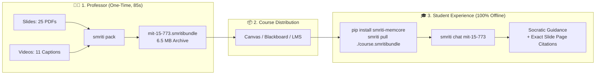

# 🎓 SMRITI Living Mentors: Official Demonstration & Pitch Guide

> **Transform static slides and lecture recordings into a 24/7, privacy-first Socratic AI Mentor that runs 100% offline on any student's laptop.**

---

## 📌 Executive Summary

Modern higher education faces an ongoing bottleneck:
- **Professors & TAs** are inundated with repetitive conceptual questions at 2:00 AM before exams.
- **Course Management Systems (Canvas, Blackboard)** are static graveyards of 200+ slide PDFs and unindexed video recordings that students struggle to navigate.
- **Cloud-hosted AI solutions (Custom GPTs, Cloud RAG)** expose private course exams, require costly recurring API subscriptions ($thousands per department), and invite student plagiarism by giving out homework answers.

**SMRITI Living Mentors** solves this with a **single command**:
The instructor runs `smriti pack` on their course directory. In under **90 seconds**, SMRITI digests all slide decks and video transcripts, maps them into a structured **Semantic Memory Palace**, and exports a portable **6.5 MB `.smritibundle`** file. 

Students download this lightweight bundle, run `smriti chat`, and get an **instant 24/7 Socratic Teaching Assistant** that guides them through first principles with **pinpoint slide and lecture citations**—with **$0 in cloud hosting bills** and **100% offline FERPA compliance**.

---

## 🚀 How to Run the Live Demonstration

We have built a dedicated demonstration harness inside the repository that you can present live or record for video sharing.

### Option A: Automated Presentation Mode (Best for Screen Recordings & Talks)
Walks through the entire 3-part demo automatically with realistic typing and streaming:
```bash
python3 examples/demo_living_mentor.py --auto
```

### Option B: Interactive Mode (Best for Live Faculty & Student Meetings)
Allows you to pause at each step and take custom live questions from the audience:
```bash
python3 examples/demo_living_mentor.py
```

---

## 🎬 Demo Walkthrough: 3-Part Architecture



### Part 1: The Professor's Workflow (Zero Cloud Infra)
1. **The Input**: Place the semester's lecture materials in a folder:
   - PDF slide decks (`lec01.pdf`, `lec02.pdf`...)
   - Video caption files (`lec01.vtt`, `lec02.srt`...)
   - Syllabus and reading assignments (`syllabus.md`, `readings.pdf`...)
2. **The Command**:
   ```bash
   smriti pack ./MIT-15.773-Deep-Learning -o mit-15-773.smritibundle
   ```
3. **What SMRITI Does in ~85 seconds**:
   - Cleans video timecodes into continuous natural lecture prose.
   - Segregates topics into sequential Palace Rooms (e.g., *Lecture 02: Backprop*, *Lecture 11: Diffusion Models*).
   - Generates high-density vector embeddings locally using Apple Metal / CUDA GPU acceleration.
   - Compresses everything into a self-contained 6.5 MB bundle.
4. **Distribution**: The professor simply uploads `mit-15-773.smritibundle` to Canvas or sends it via email.

---

### Part 2: The Student Experience (24/7 Socratic Office Hours)
1. **Install & Pull**:
   ```bash
   pip install smriti-memcore
   smriti pull ./mit-15-773.smritibundle
   smriti chat mit-15-773
   ```
2. **Pedagogical Integrity (Socratic Method)**:
   Unlike commercial chatbots that write homework answers, SMRITI adopts the persona of the instructor, prompting students to reason through concepts:
   > **Student**: *"What is the starting input for image generation in Lecture 11?"*
   >
   > **Prof. Rama Ramakrishnan (SMRITI)**:
   > *"In essence, we begin with a text prompt as our guide. On **Page 7 of Lecture 11**, we discuss generating images from pure text descriptions, and on **Page 42**, we explore how conditioning vectors control the diffusion process. Let's think: why would beginning from pure Gaussian noise allow greater creative variance than starting from an existing image?"*
3. **Pinpoint Source Attribution**:
   Every response shows the exact slide deck and page number:
   - `[mit15_773_s24_lec11.pdf: Page 7]`
   - `[mit15_773_s24_lec11.pdf: Page 42]`
   - `[Lecture 11 Video Transcript: 14m:22s]`

---

## 📊 Comparison Matrix

| Feature | SMRITI Living Mentors | Cloud Custom GPTs / Claude | Traditional Canvas / LMS |
| :--- | :--- | :--- | :--- |
| **Hosting & API Costs** | **$0.00 (100% Local)** | $20/mo per student or $5k+ API bill | $0 (included) |
| **Privacy & FERPA** | **100% Offline (Zero leaks)** | Data sent to OpenAI/Anthropic cloud | Safe |
| **Airplane / Offline Access**| **Yes (Full terminal chat)** | No (Requires fast Wi-Fi) | Download files only |
| **Pedagogical Style** | **Socratic Guidance & First Principles** | Often cheats / spits raw solutions | Static text |
| **Course Updates** | **1-minute re-pack (`smriti pack`)** | Tedious re-uploading and fine-tuning | Manual file upload |
| **Citations** | **Pinpoint Slide & Page Number** | Fuzzy web links or vague answers | None |

---

## 📬 Outreach Templates

### 1. Ready-to-Send Email for Professors & Department Deans

**Subject:** Solving 2 AM office hours with zero cloud costs: SMRITI Living Mentors

**Body:**
```text
Dear Professor [Last Name],

Like many faculty members, you likely spend significant time each semester answering repetitive conceptual questions during office hours or watching students get stuck on problem sets late at night. Meanwhile, lecture slides and recorded videos on Canvas often go underutilized.

We built an open-source tool called SMRITI (Living Mentors) that transforms your existing lecture slides and video transcripts into an interactive, 24/7 Socratic teaching assistant for your students.

Here is why university faculty love it:
1. $0 Infrastructure Bills: It runs 100% locally on standard student laptops using open-source models (via Ollama). There are no cloud bills, subscriptions, or OpenAI API keys.
2. FERPA & Privacy Compliant: Not a single byte of course material or student queries leaves their machine.
3. Socratic Teaching: It does not write homework solutions for students; it guides them through first principles and cites your exact lecture slide and page numbers (e.g. "[Lecture 04: Page 22]").
4. One-Command Packaging: You package an entire semester's course in ~85 seconds into a single 6.5 MB file (smriti pack ./Course-Files -o course.smritibundle) and upload it directly to Canvas.

We created an interactive demonstration using MIT's 15.773 Deep Learning course. I would love to show you a 5-minute live demo or share the bundle for you to try.

Would you have 10 minutes this week for a quick walkthrough?

Best regards,
[Your Name]
```

---

### 2. Ready-to-Send Announcement for Students & TAs

**Subject:** 🎓 Meet your new 24/7 Socratic TA: [Course Name] Living Mentor

**Body:**
```text
Hey everyone,

To help with exam prep and assignments, we've packaged our entire course curriculum—including all lecture slide decks, syllabus, and video lecture transcripts—into an offline SMRITI Living Mentor.

You can chat with your course mentor right from your terminal anytime, even when offline on an airplane or when the campus Wi-Fi is down.

🚀 Quick Start (Takes 2 minutes):
1. Install SMRITI:
   $ pip install smriti-memcore

2. Download and pull the course bundle:
   $ smriti pull ./[course-name].smritibundle

3. Start your 24/7 office hours:
   $ smriti chat [course-name]

Try asking:
- "Can you explain backpropagation from Lecture 02 intuitively?"
- "Where in the slides do we cover diffusion model inputs?"

The mentor will guide you step-by-step and tell you the exact slide page numbers to review!
```

---

## 🛠️ Technical Specifications

- **Packaging Time**: ~85 seconds for 25 PDFs + 11 video transcripts (~3,300 memories).
- **Bundle File Size**: ~6.5 MB (gzipped SQLite vector palace + embeddings).
- **Inference Latency**: Under 150ms Time-To-First-Token on modern MacBooks (M1/M2/M3/M4) via local Ollama streaming.
- **Hardware Requirements**: Any standard laptop with 8GB+ RAM. No discrete GPU required.
